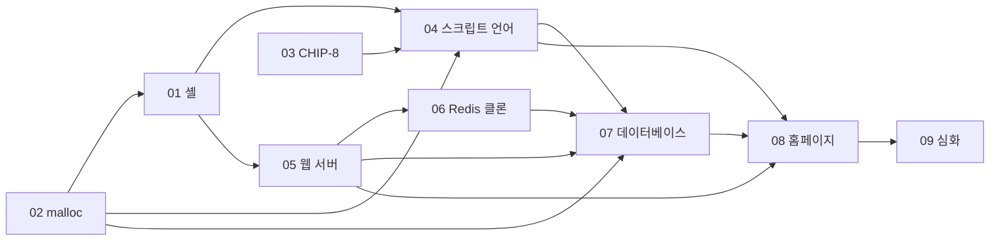

# ROADMAP

장·절 번호는 **OSTEP v1.10**, **CS:APP 3판** 기준이다.

| # | 프로젝트 | 핵심 주제 | 권장 언어(잠정) |
|---|---|---|---|
| 01 | 셸 | fork/exec/wait, 리다이렉션, 파이프, 시그널, 작업 제어 | C |
| 02 | malloc | 암시적 / 명시적 / 분리 가용 리스트 | C |
| 03 | CHIP-8 에뮬레이터 | fetch-decode-execute 루프 | C++ (C도 가능) |
| 04 | 스크립트 언어 | 렉서·파서·AST → 트리 순회 인터프리터 → 바이트코드 VM + GC | C |
| 05 | 웹 서버 | 소켓, HTTP/1.1 파싱, 스레드 풀 → epoll 이벤트 루프 | C |
| 06 | Redis 클론 | 인메모리 키-값 저장, 간단한 프로토콜, 디스크 저장 | C |
| 07 | 데이터베이스 | 페이지와 B-트리, WAL, 트랜잭션, SQL 처리 | C++ |
| 08 | 풀스택 홈페이지 | 05 서버 + 07 DB 위의 시리즈 소개 사이트 | C++ / TypeScript |
| 09 | 심화 | OS 커널, 유저 공간 TCP/IP 스택, Raft 기반 분산 키-값 저장소 | 커널 C, TCP/IP C, Raft C++ |

---

## 01 셸

fork/exec/wait, 리다이렉션, 파이프, 시그널, 작업 제어

- **권장 언어(잠정)**: C
- **읽기**
  - OSTEP: 4~6, 39(파일 디스크립터)
  - CS:APP: 8.4~8.5(프로세스 제어, 시그널), 10.8~10.9(파일 공유, 입출력 리다이렉션)
- **연결**
  - 토크나이저 → 04 렉서
  - 줄 편집기 → 04·06·07의 REPL과 CLI
  - 프로세스·시그널 처리 → 05 서버

## 02 malloc

암시적 / 명시적 / 분리 가용 리스트

- **권장 언어(잠정)**: C
- **읽기**
  - OSTEP: 13~14, 17 (배경: 18~23)
  - CS:APP: 9.8~9.9(메모리 매핑, 동적 메모리 할당), 7.13(라이브러리 인터포지셔닝)
- **연결**
  - `LD_PRELOAD`로 01 셸에 끼워 검증
  - 04 언어의 GC와 07 DB의 빈 페이지 관리로

## 03 CHIP-8 에뮬레이터

fetch-decode-execute 루프

- **권장 언어(잠정)**: C++ (C++ 기본기 연습용, C도 괜찮음)
- **읽기**
  - CS:APP: 2(정보의 표현, 비트 연산), 4(프로세서 구조)
  - OSTEP: 관련 장이 적음
- **연결**
  - 04 언어의 바이트코드 VM으로

## 04 스크립트 언어

렉서·파서·AST → 트리 순회 인터프리터 → 바이트코드 VM + GC

- **권장 언어(잠정)**: C
- **읽기**
  - CS:APP: 3(기계 수준 표현: 스택 프레임, 호출 규약), 5(성능 최적화), 9.10(가비지 컬렉션)
  - OSTEP: 관련 장이 적음
- **연결**
  - 파서 → 07 SQL 파서
  - VM → 07 쿼리 실행기
  - WebAssembly 빌드 → 08 홈페이지 플레이그라운드

## 05 웹 서버

소켓, HTTP/1.1 파싱, 스레드 풀 → epoll 이벤트 루프

- **권장 언어(잠정)**: C
- **읽기**
  - OSTEP: 26~33 (특히 33 이벤트 기반 동시성)
  - CS:APP: 10.5(RIO), 11(네트워크 프로그래밍), 12(동시성 프로그래밍)
- **연결**
  - 06·07의 네트워크 계층, 08의 백엔드로

## 06 Redis 클론

인메모리 키-값 저장, 간단한 프로토콜, 디스크 저장

- **권장 언어(잠정)**: C
- **읽기**
  - OSTEP: 33, 39, 42
  - CS:APP: 12.2(I/O 멀티플렉싱)
- **연결**
  - 07 DB로 가는 디딤돌 (영속성, 로그)

## 07 데이터베이스

페이지와 B-트리, WAL, 트랜잭션, SQL 처리

- **권장 언어(잠정)**: C++
- **읽기**
  - OSTEP: 28~32(락, 동시성 버그), 36~37(I/O 장치, 디스크),
    39~42(파일 시스템, 저널링), 44~45(SSD, 데이터 무결성)
  - CS:APP: 6(메모리 계층, 지역성)
- **연결**
  - 08 홈페이지의 저장소로

## 08 풀스택 홈페이지

05 서버와 07 DB 위에서 동작하고, 04 언어 플레이그라운드를 포함해 지금까지의 프로젝트를 소개한다.
공개 배포 시 앞단에 nginx 같은 검증된 리버스 프록시를 둔다.

- **권장 언어(잠정)**: 백엔드 C++, 프론트엔드 TypeScript
- **읽기**
  - 두 책 모두 앞 내용 복습 위주 (CS:APP 11, OSTEP 48)

## 09 심화

OS 커널, 유저 공간 TCP/IP 스택, Raft 기반 분산 키-값 저장소

- **권장 언어(잠정)**: 커널 C(+어셈블리), TCP/IP C, Raft C++
- **읽기**
  - 커널: OSTEP 가상화·동시성 파트 전체 + xv6, CS:APP 8~9를 커널 쪽에서 다시 보기
  - TCP/IP: CS:APP 11, OSTEP 48
  - Raft: OSTEP 48~50
- **연결**
  - 커널 → 01·02의 한 층 아래
  - TCP/IP → 05의 한 층 아래
  - Raft → 06·07의 확장
